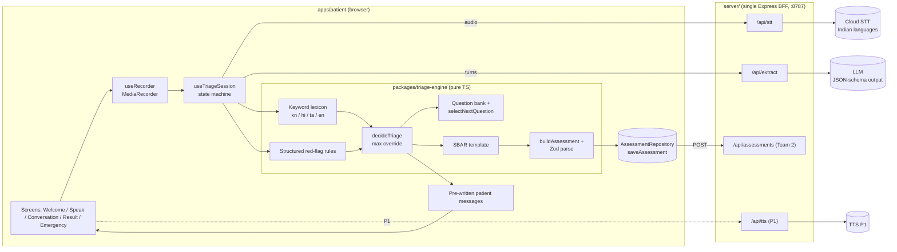
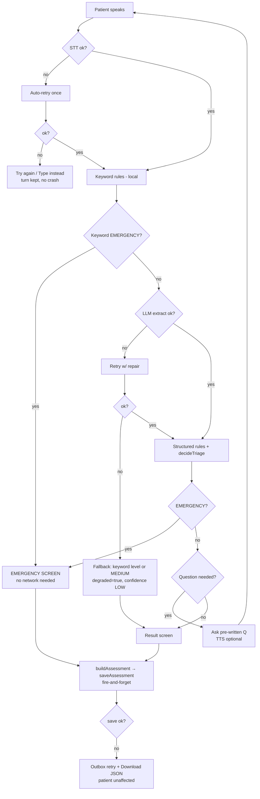
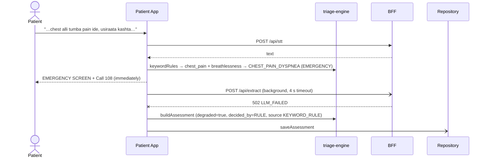

# Team 1 — Architecture: Patient Voice Assistant + Clinical Triage Engine

## 1. Architecture overview

One Vite + React + TypeScript app (`apps/patient`), one pure-TypeScript engine package (`packages/triage-engine`), and Team 1's routes in the **single shared BFF server** (`server/`, Express). No microservices, no database owned by Team 1.

Design rules that drive everything below:

1. **Safety logic runs in the browser, deterministically.** Red-flag rules, keyword lexicon, triage decision, question selection, patient messages and the SBAR note are pure functions in `packages/triage-engine`. They work if the server or LLM is down.
2. **The LLM only does language work:** normalize code-mixed speech to English and map it to a fixed symptom vocabulary as JSON. It suggests a triage level that can only *raise* the final level.
3. **Patient-facing text is pre-written**, never generated (questions, results, emergency instructions in kn/hi/en/ta). No hallucinated medical advice can reach the patient.
4. **One LLM call per patient turn**, prewritten questions, deterministic note → low latency.
5. **Emergency UI is rendered before persistence.** `saveAssessment` is fire-and-forget.

Latency budget (target, 4G): STT ≤ 2.5 s for a 10 s clip · extraction ≤ 3 s · rules/triage/note < 50 ms · emergency screen appears ≤ 1 s after transcript if keywords match (before the LLM returns). Target time-to-triage: < 60 s for emergency, < 120 s otherwise.

## 2. Architecture diagram



## 3. Voice pipeline

```
Tap mic ─▶ getUserMedia({audio:{channelCount:1, sampleRate:16000, noiseSuppression:true}})
        ─▶ MediaRecorder (audio/webm;codecs=opus) — hard cap 30 s, visible timer
Tap stop ─▶ Blob ─▶ (if provider needs WAV: decode via AudioContext → 16 kHz mono PCM WAV, ~40 lines)
        ─▶ POST /api/stt (multipart) ─▶ { text, language }
        ─▶ append patient turn ─▶ run keyword rules immediately ─▶ POST /api/extract
```

- **Phase states shown to the patient:** `idle` (pulsing mic) → `listening` (red ring + timer + waveform bars) → `transcribing` ("…" spinner) → `thinking` → `question` | `result` | `emergency`.
- **Audio format:** verify at 0:00 which formats the chosen STT accepts. If WebM/Opus is accepted, send as-is (smallest upload). Otherwise convert to WAV client-side.
- **Minimum clip length:** < 0.7 s → "Please hold and speak" (don't call STT).

## 4. STT architecture

**Provider choice (decide at 0:00, keep behind one adapter):** a cloud STT with explicit support for Kannada/Hindi/Tamil and code-mixed Indian speech (e.g. Sarvam AI's speech-to-text, Google Cloud Speech-to-Text with `kn-IN`/`hi-IN`, or Bhashini). Verify current model names, limits and accepted formats at hour 0 with one real clip per language. Generic English-first models often mangle code-mixed romanization, so test before committing.

```typescript
// server/src/routes/ai/stt/adapter.ts
export interface SttAdapter {
  name: string;
  transcribe(audio: Buffer, mime: string, languageHint: LanguageCode | null):
    Promise<{ text: string; language: LanguageCode | null }>;
}
// providers: sarvam.ts | google.ts | mock.ts  (selected by STT_PROVIDER)
```

- **Language hint:** welcome-screen choice (`kn-IN`, `hi-IN`, `en-IN`). If the provider supports auto-detect, send "auto" and use the returned code to fill `language.detected` (P1 auto-detection).
- **Code-mixed output:** we accept whatever script the STT returns (Latin, Kannada, Devanagari, or mixed). The keyword lexicon covers both romanized and native script. The LLM normalizes to English.
- **Fallbacks (in order):** (1) 1 automatic retry; (2) "Try again" button; (3) "Type instead" text box (input_mode `text`); (4) optional browser Web Speech API toggle (`SpeechRecognition`, `lang = "kn-IN" | "hi-IN"`) — Chrome only, needs network, lower code-mix quality; `stt_provider = "web-speech"`.
- **Extensibility:** adding a language = add to `LanguageCode`, STT language list, question bank strings, lexicon, patient messages. No code-path changes.

## 5. Language / code-mix handling

We do **not** build a separate language-ID or transliteration stage. Instead:

1. STT produces text in whatever mix the patient used.
2. The keyword engine scans the raw text (lower-cased, Unicode-normalized NFC, punctuation stripped) against a lexicon containing English, romanized Kannada/Hindi/Tamil, and native-script terms.
3. The LLM receives the full conversation and returns `normalized_english` plus canonical symptom codes. The prompt explicitly lists code-mixed examples.
4. `language.code_mixed = true` if the LLM reports mixing or if the text contains both Latin and Indic tokens (cheap regex check — used when LLM is down).

## 6. Clinical extraction architecture

Single endpoint: `POST /api/extract`. Stateless: the client sends **all turns so far** each time (≤ ~10 turns, small).

```typescript
// packages/triage-engine/src/extraction.ts  (Team 1 internal — NOT part of the shared contract)
export const ExtractionResultSchema = z.object({
  normalized_english: z.string(),               // whole conversation, patient turns only
  turn_translations: z.array(z.object({ turn_id: z.string(), text_english: z.string() })),
  language_detected: z.array(z.enum(["kn-IN","hi-IN","ta-IN","en-IN"])),
  code_mixed: z.boolean(),
  chief_complaint: z.string(),                  // short English phrase
  complaint_group: z.enum(["chest_pain","breathing","abdominal_pain","fever","headache",
                           "bleeding_pregnancy","injury","neuro","general"]),
  symptoms: z.array(z.object({
    code: SymptomCodeSchema, name: z.string(), present: z.boolean(),
    duration: z.string().nullable(), duration_hours: z.number().nullable(),
    severity: z.enum(["mild","moderate","severe","unknown"]),
    body_location: z.string().nullable(), onset: z.enum(["sudden","gradual","unknown"]),
    explicitly_stated: z.boolean(),             // → source REPORTED / INFERRED
    patient_words: z.string().nullable(),
  })),
  patient: z.object({                           // ONLY if explicitly said; else null
    name: z.string().nullable(), age: z.number().int().min(0).max(120).nullable(),
    sex: z.enum(["male","female","other","unknown"]),
  }),
  history: z.object({ conditions: z.array(z.string()), medications: z.array(z.string()),
    pregnancy_status: z.enum(["pregnant","possible","not_pregnant","unknown","not_applicable"]) }),
  missing_information: z.array(z.string()),     // English, human-readable
  suggested_level: z.enum(["LOW","MEDIUM","HIGH","EMERGENCY"]),
  suggested_reason: z.string(),
  suggested_red_flags: z.array(z.object({ code: z.string(), label: z.string() })),
  confidence: z.enum(["HIGH","MEDIUM","LOW"]),
});
```

**Prompt skeleton (system):**

```
You convert a rural Indian patient's speech (Kannada/Hindi/Tamil/English, often code-mixed,
possibly with STT errors) into structured JSON for a TRIAGE system. You do NOT diagnose and
you NEVER suggest medicines.
Rules:
- Output ONLY JSON matching the provided schema.
- Map every symptom to one code from the allowed list; use "other" if none fits.
- If the patient denies a symptom ("illa", "nahi", "illai", "no"), include it with present=false.
- Use answers to assistant questions (turns with question_id) as patient statements.
- Set age/name/sex ONLY if explicitly stated. Otherwise null / "unknown". Never guess.
- explicitly_stated=false for anything you inferred.
- Keep duration as spoken in `duration`; fill duration_hours only if unambiguous.
- suggested_level: be conservative; when unsure choose the higher level.
- missing_information: only items that would change urgency.
Examples:
  "Nange two days inda fever ide" → fever, present, duration "two days", 48h
  "Mereko kal se chest mein pain ho raha hai" → chest_pain, duration "since yesterday", 24h
  "usiraata kashta" / "saans lene mein taklif" / "moochu vida kashtam" → breathlessness
```

- **Model:** a fast/small tier model with native JSON-schema structured output; `temperature: 0`; max output ~800 tokens.
- **Server validates** with `ExtractionResultSchema.safeParse`. On failure → one retry with a repair message containing the Zod error. Second failure → `502 { error: "LLM_INVALID" }`.
- Client merges: `button` answers (deterministic) **override** LLM values for the same symptom code.

## 7. Follow-up question architecture

Questions are **data**, not LLM output:

```typescript
interface FollowUpQuestion {
  id: string;                         // "cp_breath"
  groups: ComplaintGroup[];           // ["chest_pain"]
  priority: number;                   // lower = asked first
  asks_about: SymptomCode | "pregnancy" | "age";
  yes_sets?: { code: SymptomCode; present: true } | { pregnancy: "possible" };
  no_sets?:  { code: SymptomCode; present: false } | { pregnancy: "not_pregnant" };
  only_if?: (ctx: SessionContext) => boolean;   // e.g. sex === "female" && age 12–50
  text: Record<"kn" | "hi" | "en" | "ta", string>;
  audio?: Record<"kn" | "hi" | "en" | "ta", string>; // P1 pre-generated mp3 path
}
```

Example rows (translations must be reviewed by native speakers during 0:30–1:30):

| id | group | asks | en | hi | kn |
|---|---|---|---|---|---|
| `cp_breath` | chest_pain | breathlessness | Are you having difficulty breathing? | क्या सांस लेने में तकलीफ हो रही है? | ಉಸಿರಾಡಲು ಕಷ್ಟವಾಗುತ್ತಿದೆಯೇ? |
| `cp_sweat` | chest_pain | sweating | Are you sweating a lot? | क्या बहुत पसीना आ रहा है? | ತುಂಬಾ ಬೆವರು ಬರುತ್ತಿದೆಯೇ? |
| `cp_radiate` | chest_pain | pain_radiating_arm_jaw | Is the pain going to your arm or jaw? | क्या दर्द हाथ या जबड़े तक जा रहा है? | ನೋವು ಕೈ ಅಥವಾ ದವಡೆಗೆ ಹರಡುತ್ತಿದೆಯೇ? |
| `cp_faint` | chest_pain | fainting | Did you faint or feel like fainting? | क्या आप बेहोश हुए या चक्कर आया? | ನೀವು ಪ್ರಜ್ಞೆ ತಪ್ಪಿದ್ದೀರಾ? |
| `ab_pregnancy` | abdominal_pain | pregnancy (`only_if` female 12–50) | Could you be pregnant? | क्या आप गर्भवती हो सकती हैं? | ನೀವು ಗರ್ಭಿಣಿಯಾಗಿರಬಹುದೇ? |
| `ab_bleed_faint` | abdominal_pain | vaginal_bleeding + fainting | Any bleeding or fainting? | क्या खून आ रहा है या बेहोशी हुई? | ರಕ್ತಸ್ರಾವ ಅಥವಾ ಪ್ರಜ್ಞೆ ತಪ್ಪುವುದು ಆಗಿದೆಯೇ? |
| `fv_breath_confusion` | fever | breathlessness + confusion | Any difficulty breathing or confusion? | सांस में तकलीफ या उलझन? | ಉಸಿರಾಟದ ತೊಂದರೆ ಅಥವಾ ಗೊಂದಲ ಇದೆಯೇ? |
| `fv_drinking` | fever | unable_to_drink (inverted) | Are you able to drink fluids? | क्या आप पानी पी पा रहे हैं? | ನೀವು ನೀರು ಕುಡಿಯಲು ಸಾಧ್ಯವಾಗುತ್ತಿದೆಯೇ? |
| `resp_breath` | general/breathing | breathlessness | Are you having difficulty breathing? | (as cp_breath) | (as cp_breath) |
| `ha_danger` | headache | fever + vomiting + limb_weakness | Any fever, vomiting, or weakness in arms/legs? | बुखार, उल्टी, या हाथ-पैर में कमज़ोरी? | ಜ್ವರ, ವಾಂತಿ ಅಥವಾ ಕೈಕಾಲು ದೌರ್ಬಲ್ಯ ಇದೆಯೇ? |
| `gen_duration` | any | duration (voice answer) | Since when do you have this problem? | यह तकलीफ कब से है? | ಈ ತೊಂದರೆ ಯಾವಾಗಿನಿಂದ ಇದೆ? |

Selection algorithm:

```
selectNextQuestion(ctx):
  if ctx.triageLevel == EMERGENCY: return null
  if ctx.questionsAsked >= 4: return null
  candidates = bank
     .filter(q => q.groups ∩ {ctx.complaintGroup, "any"} ≠ ∅)
     .filter(q => !ctx.askedIds.has(q.id))
     .filter(q => q.only_if?.(ctx) ?? true)
     .filter(q => isUnknown(ctx, q.asks_about))     // skip if patient already said yes/no
  return minBy(candidates, q => q.priority) ?? null
```

Yes/No button answers update symptoms locally (`input_mode: "button"`, `source: REPORTED`) and re-run rules instantly — no network. A voice answer goes through STT → extract.

## 8. Deterministic red-flag architecture

Two deterministic layers, both in `packages/triage-engine`, both run on every turn:

**Layer A — structured rules** over `Symptom[]` + patient snapshot + history (needs LLM extraction *or* button answers):

```typescript
interface Rule {
  code: RedFlagCode; label: string; level: TriageLevel;
  when: (s: Facts) => boolean;   // Facts = present symptom codes, severities, durations, sex, age, pregnancy
}
const RULES: Rule[] = [
  { code:"CHEST_PAIN_DYSPNEA", level:"EMERGENCY", label:"Chest pain with breathing difficulty",
    when: f => f.has("chest_pain") && f.has("breathlessness") },
  { code:"CHEST_PAIN_CARDIAC_SIGNS", level:"EMERGENCY", label:"Chest pain with sweating, radiation or fainting",
    when: f => f.has("chest_pain") && (f.has("sweating") || f.has("pain_radiating_arm_jaw") || f.has("fainting")) },
  { code:"SEVERE_BREATHLESSNESS", level:"EMERGENCY", label:"Severe breathing difficulty",
    when: f => f.sev("breathlessness") === "severe" },
  { code:"UNCONSCIOUS", level:"EMERGENCY", label:"Unconscious / unresponsive",
    when: f => f.has("unconscious") },
  { code:"SEIZURE", level:"EMERGENCY", label:"Seizure / fits", when: f => f.has("seizure") },
  { code:"STROKE_SIGNS", level:"EMERGENCY", label:"Possible stroke signs (face/limb/speech)",
    when: f => f.has("face_droop") || f.has("slurred_speech") || (f.has("limb_weakness") && f.onset("limb_weakness")==="sudden") },
  { code:"SEVERE_BLEEDING", level:"EMERGENCY", label:"Severe uncontrolled bleeding", when: f => f.has("severe_bleeding") },
  { code:"ANAPHYLAXIS_SIGNS", level:"EMERGENCY", label:"Allergic swelling with breathing difficulty",
    when: f => f.has("allergic_swelling") && (f.has("breathlessness") || f.loc("allergic_swelling")?.match(/face|lip|throat|tongue/)) },
  { code:"PREGNANCY_BLEEDING", level:"EMERGENCY", label:"Bleeding in pregnancy",
    when: f => ["pregnant","possible"].includes(f.pregnancy) && f.has("vaginal_bleeding") },
  { code:"MAJOR_TRAUMA", level:"EMERGENCY", label:"Serious injury", when: f => f.has("major_injury") },
  { code:"SEVERE_DEHYDRATION", level:"EMERGENCY", label:"Unable to drink with drowsiness/confusion",
    when: f => f.has("unable_to_drink") && (f.has("confusion") || f.has("fainting")) },
  { code:"FEVER_WITH_CONFUSION", level:"EMERGENCY", label:"Fever with confusion",
    when: f => f.has("fever") && f.has("confusion") },
  { code:"CHEST_PAIN", level:"HIGH", label:"Chest pain", when: f => f.has("chest_pain") },
  { code:"SEVERE_ABDOMINAL_PAIN", level:"HIGH", label:"Severe abdominal pain with vomiting",
    when: f => f.sev("abdominal_pain")==="severe" && f.has("vomiting") },
  { code:"PREGNANCY_ABDOMINAL_PAIN", level:"HIGH", label:"Abdominal pain, pregnancy not excluded",
    when: f => f.has("abdominal_pain") && f.sex==="female" && f.age!==null && f.age>=12 && f.age<=50
               && ["pregnant","possible","unknown"].includes(f.pregnancy) },
  { code:"PROLONGED_FEVER", level:"MEDIUM", label:"Fever lasting 5 days or more",
    when: f => f.has("fever") && (f.hours("fever") ?? 0) >= 120 },
];
```

`f.has(code)` = a symptom with that code and `present === true` exists. Absent/denied symptoms never fire rules.

**Layer B — keyword rules** over raw transcript text (works with **no LLM**). Lexicon maps phrases to symptom codes; then the *same* `RULES` run on the keyword-derived facts. Flags from this path get `source: "KEYWORD_RULE"`.

```typescript
const LEXICON: Record<SymptomCode, string[]> = {
  chest_pain:     ["chest pain","chest mein pain","chest alli pain","seene mein dard","chhati mein dard",
                   "ede novu","ಎದೆ ನೋವು","सीने में दर्द","छाती में दर्द","nenju vali","நெஞ்சு வலி"],
  breathlessness: ["breathing problem","saans","सांस","usiraata","usiru","ಉಸಿರಾಟ","ಉಸಿರು",
                   "moochu","மூச்சு","breathless","dum ghut"],
  sweating:       ["sweat","pasina","पसीना","bevaru","ಬೆವರು","viyarvai","வியர்வை"],
  unconscious:    ["unconscious","behosh","बेहोश","prajne illa","ಪ್ರಜ್ಞೆ ಇಲ್ಲ","mayakkam","மயக்கம்"],
  seizure:        ["fits","seizure","daura","दौरा","mirgi","मिर्गी","ಫಿಟ್ಸ್","valippu","வலிப்பு"],
  severe_bleeding:["lots of blood","bahut khoon","बहुत खून","tumba rakta","ತುಂಬಾ ರಕ್ತ","niraya ratham"],
  // … one entry per emergency-relevant code; ~8–12 phrases each. Mark unreviewed entries with // TODO-NATIVE
};
```

Matching: NFC-normalize, lower-case, collapse whitespace, substring match. **P0 deliberately has no negation handling** in Layer B: a phrase like "chest pain nahi hai" may over-triage. That is the safe failure direction and is documented on the result screen for the ASHA ("keyword-detected"). P1: simple negation window (`nahi|illa|illai|no|not` within 3 tokens after) downgrades a *keyword-only* flag to a follow-up question rather than suppressing it.

## 9. Triage algorithm & emergency override logic

**Invariant:** `TRIAGE_ORDER[final.level] >= TRIAGE_ORDER[rule_level ?? "LOW"]`. Nothing the LLM returns can lower a deterministic level. Enforced in code *and* by a unit test *and* asserted before `buildAssessment`.

```typescript
// packages/triage-engine/src/triage.ts
const maxLevel = (ls: (TriageLevel | null)[]) =>
  ls.filter(Boolean).reduce<TriageLevel | null>((a, b) =>
    a === null || TRIAGE_ORDER[b!] > TRIAGE_ORDER[a] ? b! : a, null);

export function decideTriage(input: {
  structuredFlags: RedFlag[];        // Layer A on merged facts (LLM + buttons)
  keywordFlags: RedFlag[];           // Layer B on raw transcript
  extraction: ExtractionResult | null; // null if LLM failed
  criticalMissing: string[];
}): TriageResult {
  const flags = dedupeByCode([...input.structuredFlags, ...input.keywordFlags]);
  const ruleLevel  = maxLevel(flags.map(f => f.level));
  const modelLevel = input.extraction?.suggested_level ?? null;

  let level = maxLevel([ruleLevel, modelLevel]);          // LLM may only RAISE
  let decided_by: TriageResult["decided_by"] =
      ruleLevel && modelLevel ? (TRIAGE_ORDER[ruleLevel] >= TRIAGE_ORDER[modelLevel] ? "RULE" : "MODEL")
    : ruleLevel ? "RULE" : modelLevel ? "MODEL" : "FALLBACK";
  if (ruleLevel && modelLevel && ruleLevel === modelLevel) decided_by = "RULE_AND_MODEL";

  let confidence: Confidence = input.extraction?.confidence ?? "LOW";

  if (level === null) {                                   // LLM down and no rule fired
    level = "MEDIUM"; decided_by = "FALLBACK"; confidence = "LOW";
  }
  if (level === "LOW" && (confidence === "LOW" || input.criticalMissing.length > 0)) {
    level = "MEDIUM";                                     // uncertainty never presented as certainty
  }
  if (ruleLevel && TRIAGE_ORDER[level] < TRIAGE_ORDER[ruleLevel]) {
    throw new Error("INVARIANT: triage below deterministic level");  // unreachable; tested
  }
  return {
    level, confidence, rule_level: ruleLevel, model_level: modelLevel, decided_by,
    requires_escalation: level === "EMERGENCY",
    reason: reasonFor(level, flags, input.extraction),
    recommended_action: ACTION_BY_LEVEL[level],
    recommended_facility_type: FACILITY_BY_LEVEL[level],  // EMERGENCY→EMERGENCY_HOSPITAL, HIGH→CHC, MEDIUM→PHC, LOW→null
  };
}
```

LLM-suggested red flags are stored with `source: "LLM_SUGGESTED"` for the note, but their *effect* on level is only via `model_level` (which can only raise).

**Session pipeline pseudocode (per patient turn):**

```
onPatientTurn(turn):
  session.turns.push(turn)
  kwFlags = keywordRules(allPatientText(session.turns))             // < 5 ms, local
  if maxLevel(kwFlags) == EMERGENCY:
      finalize("EMERGENCY")                                          // show emergency screen NOW
      extractInBackground(timeout = 4s) → enrich note if it returns  // never blocks UI
      return

  extraction = await extractWithRetry(session.turns, timeout=10s, retries=1)   // may be null
  if extraction == null: session.pipeline.degraded = true; errors.push("LLM_FAILED")
  facts      = mergeFacts(extraction?.symptoms, session.buttonAnswers)     // buttons win
  structFlags= structuredRules(facts, session.patient)
  triage     = decideTriage({structFlags, kwFlags, extraction, criticalMissing(facts)})

  if triage.level == EMERGENCY: finalize(triage); return
  if extraction == null and !retryOffered: showRetry(); return              // patient can retry once
  q = selectNextQuestion(ctx(session, facts, triage))
  if q != null: ask(q); return
  finalize(triage)

onButtonAnswer(q, yes):
  session.buttonAnswers.apply(q, yes); session.turns.push(buttonTurn)
  re-run structuredRules + decideTriage locally (no network)
  same branching as above (EMERGENCY → finalize; next question; else finalize)

finalize(triage):
  render Result/Emergency screen FIRST (pre-written message in selected language)
  if EMERGENCY: create EscalationEvent {patient_instruction_shown:true, emergency_call_offered:true}
  note = buildClinicalNote(...)
  a = buildAssessment(...); AssessmentSchema.parse(a)
  repository.saveAssessment(a).catch(markSavedLocally)                    // fire-and-forget
```

## 10. Structured-output strategy

| Layer | Mechanism |
|---|---|
| LLM call | Provider's native JSON-schema / structured-output mode, generated from `ExtractionResultSchema` via `zod-to-json-schema` |
| Server | `safeParse` → 1 repair retry → `502 LLM_INVALID` |
| Client | Re-validates response (defence in depth), coerces unknown symptom codes to `"other"` |
| Engine output | `AssessmentSchema.parse` (strict) in `buildAssessment` |
| Tests | Every golden scenario asserts schema validity |

## 11. Clinical-note generation

**P0: deterministic template** (`buildClinicalNote`), so the note can never contain facts that are not in the structured data:

- `situation`: `{age? "N-year-old" : "Patient (age not provided)"} {sex if known} reports {chief_complaint}{ with positives}.`
- `background`: conditions, medications, pregnancy status — each "not reported" if empty; "not asked — emergency short-circuit" when applicable.
- `assessment`: `Triage {LEVEL}. {Deterministic red flags: codes | No red flags}. Not a diagnosis.`
- `recommendation`: from `ACTION_BY_LEVEL` + escalation facts.
- `relevant_positives` / `relevant_negatives`: from `present` true/false symptoms.
- `reported_information`: symptoms with `source: REPORTED` + stated demographics + button answers.
- `inferred_information`: normalizations (`duration_hours`), `INFERRED` symptoms, rule-derived facts (e.g. "pregnancy not excluded").
- `vitals: "NOT_RECORDED"`; fixed `disclaimer`; `text` = rendered plain-text block (see fixtures).

**P1:** LLM rewrites only the `situation` sentence from the structured JSON (`generated_by: "TEMPLATE_PLUS_LLM"`); if it fails or adds facts not in input, keep the template.

## 12. Patient ID handling

```typescript
// apps/patient/src/services/patientIdentity.ts
const KEY = "rht.patient";
export function getOrCreatePatient(): { patient_id: string; display_id: string } {
  const saved = safeJson(localStorage.getItem(KEY));
  if (saved?.patient_id) return saved;
  return newPatient();
}
export function newPatient() {
  const p = { patient_id: crypto.randomUUID(), display_id: makeDisplayId() };
  localStorage.setItem(KEY, JSON.stringify(p)); return p;
}
// Crockford base32, 4 chars, no I/L/O/U: "PAT-7K2Q" (~1M space; display only, uniqueness via UUID)
const makeDisplayId = () => "PAT-" + Array.from(crypto.getRandomValues(new Uint8Array(4)))
  .map(b => "0123456789ABCDEFGHJKMNPQRSTVWXYZ"[b % 32]).join("");
```

- `assessment_id = crypto.randomUUID()` at conversation start; `patient_id` from identity.
- Welcome screen shows "Continue as PAT-7K2Q" vs "New patient" (big buttons). Demo: run Scenario 2 twice → same patient, two assessments.
- Demographics captured on welcome (sex tap, optional age stepper) are `REPORTED`. Name/village only if spoken or typed. Snapshot = latest known values on this device.

## 13. Shared TypeScript types

Team 1 imports everything from `@rht/shared` (`packages/shared`). The full list is in the **Cross-Team Integration Contract** at the end of this document. Team 1–internal types (`ExtractionResult`, `FollowUpQuestion`, `Rule`, `SessionContext`) live in `packages/triage-engine` and are **not** part of the contract.

## 14. Zod / JSON schema approach

- `packages/shared/src/schemas.ts` holds Zod schemas for the contract; TS types are checked with `z.infer` equality tests (`expectTypeOf`).
- Producer: strict parse. Consumer: passthrough parse.
- JSON Schema for LLM generated from Zod at server start (`zod-to-json-schema`), so prompt schema and validation never drift.
- `pnpm validate:fixtures` (Node script) parses every fixture; CI-less hackathon → run before every merge.

## 15. Repository interfaces & API boundary

Team 1 uses exactly:

```typescript
import type { AssessmentRepository } from "@rht/shared";
// apps/patient/src/services/repository.ts — the ONE line changed at integration
export const repository: AssessmentRepository =
  import.meta.env.VITE_REPO === "http"
    ? new HttpAssessmentRepository("/api")      // provided by Team 2 in @rht/shared
    : new ConsoleAssessmentRepository();        // logs + localStorage + download
```

API boundary:

| Boundary | Direction | Contract |
|---|---|---|
| Browser → `/api/stt`, `/api/extract`, `/api/tts` | Team 1 internal | §4, §6, plan §10 |
| Browser → `saveAssessment` | Team 1 → shared repo | `Assessment` v1.0 |
| Server `/api/assessments` | Team 2 | Contract C.4 |

## 16. Failure-isolation architecture



| Component fails | Isolation |
|---|---|
| STT | Retry, type-instead; keyword/LLM unaffected |
| LLM | Keyword rules + button answers still decide; conservative MEDIUM floor |
| TTS | Text always rendered; audio is an enhancement |
| Server entirely down | Emergency keyword path + pre-written messages still work for typed input; result shown; JSON downloadable |
| Team 2 store / ASHA app | Invisible to patient; outbox in repository |
| React render error | `ErrorBoundary` per screen with "Start again" and always-visible emergency number |

`FORCE_FAIL` env on the server (`stt|llm|tts`) makes failure demos deterministic.

## 17. Security / API-key handling

- Keys only in `server/.env` (gitignored); `.env.example` committed with blanks.
- Browser calls only same-origin `/api/*` (Vite proxy in dev). No provider SDK in `apps/`.
- Server: `express.json({limit:"200kb"})`, `multer` limit 2 MB / 30 s audio, simple per-IP rate limit (in-memory, 30 req/min) to protect keys during public demo.
- No audio is persisted by default. Transcripts are stored in the assessment (demo data only).
- Log redaction: server logs request IDs and timings, not transcripts.
- Post-hackathon (not built): auth, consent, encryption at rest, DPDP Act compliance review.

## 18. Integration boundary with Team 2

- Team 1 → Team 2 is **one object** (`Assessment`) through **one method** (`saveAssessment`).
- Team 1 never imports from `apps/asha` and never calls `/api/sync` or reads IndexedDB.
- Team 2 never calls Team 1 endpoints and never recomputes triage.
- If integration breaks at demo time: patient app **Download JSON** → ASHA **Import JSON**.

## 19. Sequence diagrams

**Normal path with follow-up (Scenario 2):**

```mermaid
sequenceDiagram
  actor P as Patient
  participant UI as Patient App
  participant ENG as triage-engine (local)
  participant S as BFF /api
  participant STT as Cloud STT
  participant LLM as LLM
  participant R as AssessmentRepository

  P->>UI: Tap mic, speak (Kanglish), tap stop
  UI->>S: POST /api/stt (audio, kn-IN)
  S->>STT: transcribe
  STT-->>S: "Nange one week inda fever ide…"
  S-->>UI: {text, language}
  UI->>ENG: keywordRules(text) → no EMERGENCY
  UI->>S: POST /api/extract (turns)
  S->>LLM: JSON-schema request
  LLM-->>S: ExtractionResult
  S-->>UI: validated ExtractionResult
  UI->>ENG: structuredRules + decideTriage → MEDIUM (PROLONGED_FEVER)
  UI->>ENG: selectNextQuestion → fv_breath_confusion
  UI-->>P: Question (Kannada text + audio) [✓] [✗]
  P->>UI: ✗ (No)
  UI->>ENG: re-run rules locally → still MEDIUM; next Q fv_drinking
  P->>UI: "Haudu, kudeetini" (voice) → STT → extract
  UI->>ENG: decideTriage → MEDIUM, no more questions
  UI-->>P: Yellow result "Please consult a healthcare worker"
  UI->>ENG: buildClinicalNote + buildAssessment (Zod)
  UI-)R: saveAssessment(a) (not awaited)
```

**Emergency short-circuit with LLM down (Scenario 6a):**



## 20. Example Assessment JSON

See `packages/shared/mock/emergency.json` (full) and contract §C.3 (abridged). Team 1's live output for Scenario 4 must match it on: `schema_version`, `triage.level = EMERGENCY`, `requires_escalation = true`, `escalation != null`, red-flag code `CHEST_PAIN_DYSPNEA`, `vitals = NOT_RECORDED`, `patient.sex = "unknown"` unless the patient selected it.

## 21. Folder structure (Team 1 owned parts in **bold**)

```text
rural-health-triage/
├── package.json                 # pnpm workspaces; scripts: dev, test, validate:fixtures
├── pnpm-workspace.yaml
├── .env.example
├── apps/
│   ├── **patient/**             # Vite React TS, :5173
│   │   ├── src/
│   │   │   ├── screens/         # Welcome, Speak, Conversation, Result, Emergency
│   │   │   ├── components/      # MicButton, QuestionCard, TranscriptBubble, ErrorBoundary
│   │   │   ├── hooks/           # useRecorder, useTriageSession, useTts (P1)
│   │   │   ├── services/        # sttClient, extractClient, repository.ts, patientIdentity.ts
│   │   │   ├── i18n/            # patientMessages.ts (kn/hi/en/ta)
│   │   │   └── main.tsx
│   │   ├── public/audio/        # P1 pre-generated question/result audio
│   │   └── test/extractions/    # golden ExtractionResult fixtures
│   └── asha/                    # Team 2
├── packages/
│   ├── shared/                  # JOINT, FROZEN at 0:30
│   │   ├── src/{types,schemas,constants,repositories}.ts
│   │   ├── src/repositories/{http,console}.ts   # Team 2 implements
│   │   └── mock/*.json
│   └── **triage-engine/**       # pure TS, vitest
│       └── src/{rules,lexicon,triage,questions,note,assessment,extraction}.ts
└── server/                      # single Express BFF, :8787
    └── src/
        ├── index.ts             # mounts both route groups, /api/health
        ├── **routes/ai/**       # stt/, extract/, tts/ (Team 1)
        └── routes/store/        # assessments, sync (Team 2)
```

Improvements over the suggested structure: `triage-engine` is a separate pure package (unit-testable, no React, reusable offline); server routes split by team folder in **one** process; `pages/` replaced by `screens/` with a phase state machine (no router needed for 5 linear screens).

---

## System-wide safety requirements & offline truth table (shared by both teams)

| # | Requirement | How it is enforced | Owner |
|---|---|---|---|
| 1 | Triage, **not** diagnosis | No disease names in patient UI; `assessment` SBAR field says "Not a diagnosis"; LLM prompt forbids diagnosis | T1 |
| 2 | No medication prescription | Patient-facing text is pre-written; LLM output never shown to patient; prompt forbids medicines | T1 |
| 3 | Emergency rules override generative reasoning | `decideTriage` = `max(rule_level, model_level)` | T1 |
| 4 | LLM cannot downgrade deterministic red flags | Invariant check + unit test "LLM says LOW, rules say EMERGENCY → EMERGENCY" | T1 |
| 5 | Emergency guidance does not depend on ASHA sync | Emergency screen rendered before `saveAssessment`; save is fire-and-forget | T1 |
| 6 | Low confidence not presented as certainty | LOW + low confidence/critical missing info → floored to MEDIUM; `confidence` stored; degraded badge in ASHA UI | T1 / T2 display |
| 7 | Missing critical info triggers clarification | Question bank asks up to 4 targeted questions before finalizing (except EMERGENCY) | T1 |
| 8 | Note distinguishes reported vs inferred | `reported_information` vs `inferred_information`, `Symptom.source` | T1 / T2 display |
| 9 | No fabricated vitals | `vitals: "NOT_RECORDED"` literal type | T1 |
| 10 | No fabricated patient info | Age/sex/name only if stated or tapped; else `null`/`"unknown"` | T1 |
| 11 | No fabricated facility capabilities | Directory is static, labelled DEMO; unlisted service = absent | T2 |
| 12 | Suitability over proximity for emergencies | `rankFacilities` sorts `capable` before distance; unit test | T2 |
| — | Team 2 never modifies clinical fields | No edit UI; ingest keeps clinical fields as received | T2 |

| Works offline (no internet) | Needs internet |
|---|---|
| ASHA dashboard, cached patients, assessments, notes | Cloud STT |
| Cached facility directory + ranking | LLM extraction (normalization, symptom mapping) |
| Referral create/update, ASHA notes, pending queue | Cloud TTS (P1) — pre-generated audio files for fixed phrases work offline once loaded |
| Patient app: keyword red-flag engine, triage rules, pre-written messages, emergency screen **for typed input** (the logic is local; only speech recognition is cloud) | Pushing/pulling between patient app, server and ASHA app |

We do **not** claim cloud speech or LLM features work offline. P2 explores on-device emergency phrase detection.

---

# Cross-Team Integration Contract — DO NOT MODIFY INDEPENDENTLY

> **Status:** FROZEN at hackathon time 0:30.
> **Contract version:** `schema_version = "1.0"`
> **Lives in code at:** `packages/shared/src/` (`types.ts`, `schemas.ts`, `repositories.ts`, `constants.ts`) and `packages/shared/mock/*.json`.
> This section is **identical** in `team-1/architecture.md` and `team-2/architecture.md`. Any change needs a 2-minute sync between both team leads, a bump of `schema_version` (see C.6), and an update in **both** documents and in `packages/shared`.

## C.1 Shared enums

```typescript
// packages/shared/src/types.ts  (enums section)

export const SCHEMA_VERSION = "1.0" as const;

export type TriageLevel = "LOW" | "MEDIUM" | "HIGH" | "EMERGENCY";
export const TRIAGE_ORDER: Record<TriageLevel, number> = {
  LOW: 0, MEDIUM: 1, HIGH: 2, EMERGENCY: 3,
};

export type LanguageCode = "kn-IN" | "hi-IN" | "ta-IN" | "en-IN";
export type Sex = "male" | "female" | "other" | "unknown";
export type Severity = "mild" | "moderate" | "severe" | "unknown";
export type Onset = "sudden" | "gradual" | "unknown";
export type Confidence = "HIGH" | "MEDIUM" | "LOW";

/** REPORTED = patient said it. INFERRED = derived by the system (LLM or rule). */
export type InfoSource = "REPORTED" | "INFERRED";

/** DETERMINISTIC_RULE = structured rule on extracted symptoms.
 *  KEYWORD_RULE       = deterministic lexicon match on raw transcript (works without LLM).
 *  LLM_SUGGESTED      = model-suggested; can only RAISE triage, never lower it. */
export type RedFlagSource = "DETERMINISTIC_RULE" | "KEYWORD_RULE" | "LLM_SUGGESTED";

export type PregnancyStatus =
  | "pregnant" | "possible" | "not_pregnant" | "unknown" | "not_applicable";

export type ReferralStatus =
  | "NOT_REFERRED" | "PENDING" | "REFERRED" | "ACKNOWLEDGED" | "COMPLETED";

export type SyncStatus = "LOCAL_ONLY" | "PENDING" | "SYNCED" | "FAILED";

export type FacilityType =
  | "SUB_CENTRE" | "PHC" | "CHC" | "DISTRICT_HOSPITAL" | "EMERGENCY_HOSPITAL";

export type FacilityService =
  | "general_opd" | "emergency_24x7" | "cardiac_care" | "obstetric_emergency"
  | "trauma" | "stroke_care" | "blood_transfusion" | "pediatrics" | "lab" | "ambulance";

/** Canonical symptom vocabulary. The LLM MUST map every symptom to one of these
 *  (or "other"). Deterministic rules only read these codes. */
export type SymptomCode =
  | "chest_pain" | "pain_radiating_arm_jaw" | "breathlessness" | "sweating"
  | "fainting" | "unconscious" | "seizure" | "face_droop" | "limb_weakness"
  | "slurred_speech" | "confusion" | "severe_bleeding" | "vaginal_bleeding"
  | "allergic_swelling" | "major_injury" | "unable_to_drink" | "vomiting"
  | "diarrhea" | "fever" | "cough" | "runny_nose" | "sore_throat" | "headache"
  | "abdominal_pain" | "body_ache" | "rash" | "dizziness" | "loss_of_appetite"
  | "burning_urination" | "other";

/** Red-flag codes used in v1.0. String type so new codes are an additive (minor) change. */
export type RedFlagCode = string;
export const RED_FLAG_CODES = [
  "CHEST_PAIN_DYSPNEA",       // EMERGENCY
  "CHEST_PAIN_CARDIAC_SIGNS", // EMERGENCY (chest pain + sweating / radiation / fainting)
  "SEVERE_BREATHLESSNESS",    // EMERGENCY
  "UNCONSCIOUS",              // EMERGENCY
  "SEIZURE",                  // EMERGENCY
  "STROKE_SIGNS",             // EMERGENCY
  "SEVERE_BLEEDING",          // EMERGENCY
  "ANAPHYLAXIS_SIGNS",        // EMERGENCY
  "PREGNANCY_BLEEDING",       // EMERGENCY
  "MAJOR_TRAUMA",             // EMERGENCY
  "SEVERE_DEHYDRATION",       // EMERGENCY
  "FEVER_WITH_CONFUSION",     // EMERGENCY
  "CHEST_PAIN",               // HIGH (chest pain alone is never below HIGH)
  "SEVERE_ABDOMINAL_PAIN",    // HIGH
  "PREGNANCY_ABDOMINAL_PAIN", // HIGH
  "PROLONGED_FEVER",          // MEDIUM (fever >= 5 days)
] as const;
```

## C.2 Shared types

```typescript
// packages/shared/src/types.ts  (entities section)

export interface Patient {
  patient_id: string;          // UUID v4 — the ONLY join key
  display_id: string;          // "PAT-7K2Q" — human-readable, NOT guaranteed unique
  name: string | null;         // null unless the patient/ASHA provided it
  age: number | null;          // null unless stated — never guessed
  sex: Sex;
  village: string | null;
  phone: string | null;
  created_at: string;          // ISO-8601
  updated_at: string;          // ISO-8601
}

/** Copy of what was known about the patient AT assessment time (Team 1 writes). */
export type PatientSnapshot = Pick<Patient, "name" | "age" | "sex" | "village" | "phone">;

export interface ConversationTurn {
  turn_id: string;
  role: "patient" | "assistant";
  text: string;                       // exactly as transcribed / shown
  text_english: string | null;        // normalized English, if available
  input_mode: "voice" | "text" | "button";
  question_id: string | null;         // set for assistant questions and button answers
  created_at: string;
}

export interface Symptom {
  code: SymptomCode;
  name: string;                       // English label: "chest pain"
  present: boolean;                   // false => relevant negative ("no fever")
  duration: string | null;            // as reported: "30 minutes", "2 days"
  duration_hours: number | null;      // normalized if derivable, else null
  severity: Severity;
  body_location: string | null;
  onset: Onset;
  source: InfoSource;
  patient_words: string | null;       // original phrase, e.g. "chest alli tumba pain"
}

export interface RedFlag {
  code: RedFlagCode;
  label: string;                      // English, clinician-readable
  level: TriageLevel;                 // minimum triage level this flag forces
  source: RedFlagSource;
  evidence: string[];                 // symptom codes and/or matched phrases
}

export interface TriageResult {
  level: TriageLevel;                 // FINAL level. Team 2 must never change it.
  reason: string;                     // one line, English
  requires_escalation: boolean;       // true iff level === "EMERGENCY"
  confidence: Confidence;
  rule_level: TriageLevel | null;     // max level from deterministic + keyword rules
  model_level: TriageLevel | null;    // LLM suggestion; null if LLM unavailable
  decided_by: "RULE" | "MODEL" | "RULE_AND_MODEL" | "FALLBACK";
  recommended_action: string;         // English, for ASHA/doctor
  recommended_facility_type: FacilityType | null; // minimum suitable facility type
}

export interface EscalationEvent {
  event_id: string;                   // UUID
  created_at: string;
  reason: string;
  red_flag_codes: RedFlagCode[];
  patient_instruction_shown: boolean; // emergency screen was displayed on device
  emergency_call_offered: boolean;    // "Call 108" affordance was shown
}

export interface ClinicalNote {
  format: "SBAR";
  situation: string;
  background: string;
  assessment: string;                 // triage reasoning — NOT a diagnosis
  recommendation: string;
  relevant_positives: string[];
  relevant_negatives: string[];
  reported_information: string[];     // what the patient said
  inferred_information: string[];     // what the system derived (labelled as such)
  missing_information: string[];
  vitals: "NOT_RECORDED";             // v1.0 never records vitals — never fabricate
  disclaimer: string;
  generated_by: "TEMPLATE" | "TEMPLATE_PLUS_LLM";
  text: string;                       // pre-rendered plain-text note for display/copy
}

export interface ReferralSummary {    // embedded in Assessment; TEAM 2 OWNS
  status: ReferralStatus;
  referral_id: string | null;
  facility_id: string | null;
  updated_at: string | null;
}

export interface SyncMetadata {       // TEAM 2 OWNS (Team 1 only sets initial value)
  status: SyncStatus;
  last_synced_at: string | null;
  updated_at: string;
  origin: "patient_app" | "asha_app" | "mock";
}

export interface Assessment {
  schema_version: "1.0";
  assessment_id: string;              // UUID v4
  patient_id: string;                 // UUID v4 (FK -> Patient)
  patient_display_id: string;
  created_at: string;                 // conversation start
  completed_at: string;               // triage finalized

  language: { primary: LanguageCode; detected: LanguageCode[]; code_mixed: boolean };
  patient: PatientSnapshot;
  transcript: { original: string; normalized_english: string; turns: ConversationTurn[] };

  chief_complaint: string;            // English, short
  symptoms: Symptom[];
  history: { conditions: string[]; medications: string[]; pregnancy_status: PregnancyStatus };

  red_flags: RedFlag[];
  triage: TriageResult;
  escalation: EscalationEvent | null; // non-null iff triage.requires_escalation
  clinical_note: ClinicalNote;
  missing_information: string[];

  pipeline: {
    degraded: boolean;                // true if STT/LLM failed and fallbacks were used
    stt_provider: string;             // "sarvam" | "web-speech" | "typed" | "mock"
    llm_model: string | null;
    time_to_triage_ms: number | null;
    errors: string[];                 // short codes: "LLM_TIMEOUT", "STT_FAILED"
  };

  // ---- TEAM 2 OWNED (Team 1 writes the defaults below and never touches again) ----
  referral: ReferralSummary;          // default { status:"NOT_REFERRED", referral_id:null, facility_id:null, updated_at:null }
  sync: SyncMetadata;                 // default { status:"PENDING", last_synced_at:null, updated_at:<completed_at>, origin:"patient_app" }
}

export interface Referral {
  referral_id: string;                // UUID
  assessment_id: string;
  patient_id: string;
  facility_id: string;
  triage_level: TriageLevel;          // COPIED from assessment.triage.level — read-only
  status: ReferralStatus;
  reason: string;
  history: { status: ReferralStatus; at: string; note: string | null }[];
  created_at: string;
  updated_at: string;
  sync: SyncMetadata;
}

export interface Facility {
  facility_id: string;                // "FAC-PHC-01"
  name: string;
  type: FacilityType;
  village: string;
  latitude: number;
  longitude: number;
  phone: string;
  emergency_capable: boolean;
  open_24x7: boolean;
  services: FacilityService[];
  is_demo_data: true;                 // v1.0 directory is fictional demo data
  last_verified: string | null;
}

export interface SyncOp {             // TEAM 2 OWNS — ASHA offline queue item
  op_id: string;                      // UUID, idempotency key
  type: "REFERRAL_UPSERT" | "ASHA_NOTE_ADD" | "FOLLOWUP_UPDATE";
  entity_id: string;
  payload: Referral | AshaNote | { assessment_id: string; follow_up_done: boolean };
  created_at: string;
  attempts: number;
  status: "QUEUED" | "SENDING" | "FAILED";
  last_error: string | null;
}

export interface AshaNote {           // P1, TEAM 2 OWNS
  note_id: string;
  patient_id: string;
  assessment_id: string | null;
  text: string;
  created_at: string;
  sync: SyncMetadata;
}
```

### Validation

- `packages/shared/src/schemas.ts` contains Zod schemas that mirror every interface above (`AssessmentSchema`, `ReferralSchema`, `FacilitySchema`, …). Types are derived from or checked against them.
- **Producer (Team 1):** `AssessmentSchema.parse(a)` (strict) before `saveAssessment`. A failure is a Team 1 bug and must be fixed, never bypassed.
- **Consumer (Team 2):** `AssessmentSchema.safeParse(a)` on ingest. Unknown extra fields are tolerated (`.passthrough()`), missing required fields are rejected into an "Import errors" list — the dashboard never crashes on bad input.
- `pnpm validate:fixtures` validates every file in `packages/shared/mock/` and must pass at all times.

## C.3 Assessment schema — canonical example (abridged emergency case)

```json
{
  "schema_version": "1.0",
  "assessment_id": "692cafa2-f142-4b84-b4b6-578e9dc5628f",
  "patient_id": "6a6e4387-df62-4d88-b971-b49e049c893d",
  "patient_display_id": "PAT-9D4K",
  "created_at": "2026-11-18T09:12:05.000Z",
  "completed_at": "2026-11-18T09:12:41.000Z",
  "language": { "primary": "kn-IN", "detected": ["kn-IN", "en-IN"], "code_mixed": true },
  "patient": { "name": null, "age": 54, "sex": "unknown", "village": "Hosahalli", "phone": null },
  "transcript": {
    "original": "Nange half an hour inda chest alli tumba pain ide, usiraata kashta aagtide, bevaru bartide. Nanage fifty four years.",
    "normalized_english": "I have had severe chest pain for half an hour, I am having difficulty breathing, and I am sweating. I am fifty-four years old.",
    "turns": ["…see shared/mock/emergency.json…"]
  },
  "chief_complaint": "Severe chest pain for 30 minutes",
  "symptoms": ["…chest_pain, breathlessness, sweating…"],
  "red_flags": [
    { "code": "CHEST_PAIN_DYSPNEA", "label": "Chest pain with breathing difficulty",
      "level": "EMERGENCY", "source": "DETERMINISTIC_RULE", "evidence": ["chest_pain", "breathlessness"] }
  ],
  "triage": {
    "level": "EMERGENCY", "reason": "Chest pain with breathing difficulty and sweating",
    "requires_escalation": true, "confidence": "HIGH",
    "rule_level": "EMERGENCY", "model_level": "EMERGENCY", "decided_by": "RULE_AND_MODEL",
    "recommended_action": "Immediate emergency evaluation. Arrange ambulance (108).",
    "recommended_facility_type": "EMERGENCY_HOSPITAL"
  },
  "escalation": { "event_id": "27d209a0-2f6b-45f6-9161-a775f430b45e", "…": "…" },
  "referral": { "status": "NOT_REFERRED", "referral_id": null, "facility_id": null, "updated_at": null },
  "sync": { "status": "PENDING", "last_synced_at": null, "updated_at": "2026-11-18T09:12:41.000Z", "origin": "patient_app" }
}
```

The complete, valid documents are the fixtures in C.7.

## C.4 Repository interfaces

```typescript
// packages/shared/src/repositories.ts

export interface AssessmentRepository {
  saveAssessment(assessment: Assessment): Promise<void>;   // idempotent on assessment_id
  getAssessment(id: string): Promise<Assessment | null>;
  getAssessmentsForPatient(patientId: string): Promise<Assessment[]>; // newest first
  getAllAssessments(): Promise<Assessment[]>;
}

export interface PatientRepository {
  upsertFromAssessment(a: Assessment): Promise<Patient>;   // merge rule in C.5
  getPatient(patientId: string): Promise<Patient | null>;
  getAllPatients(): Promise<Patient[]>;
}

export interface ReferralRepository {
  createReferral(referral: Referral): Promise<void>;
  updateReferral(referral: Referral): Promise<void>;
  getReferralForAssessment(assessmentId: string): Promise<Referral | null>;
  getReferralsForPatient(patientId: string): Promise<Referral[]>;
}

export interface FacilityRepository {
  getAllFacilities(): Promise<Facility[]>;
  getFacility(id: string): Promise<Facility | null>;
}
```

**Implementations (Team 2 owns all of them):**

| Implementation | Where | Used by |
|---|---|---|
| `HttpAssessmentRepository` | `packages/shared/src/repositories/http.ts` | Team 1 patient app. `saveAssessment` = `POST /api/assessments`; on failure stores in a `localStorage` outbox (`rht.outbox`) and retries every 15 s and on `online` event. |
| `ConsoleAssessmentRepository` | `packages/shared/src/repositories/console.ts` | Team 1 until hour ~5:30. Logs, keeps a copy in `localStorage`, exposes "Download JSON". |
| `DexieAssessmentRepository`, `DexiePatientRepository`, `DexieReferralRepository`, `StaticFacilityRepository` | `apps/asha/src/data/` | Team 2 ASHA dashboard only. |

**Team 1 calls exactly one method: `saveAssessment(assessment)`, and never `await`s it before showing the patient their result.**

### Transport between the two apps

The two apps run on different origins (5173 / 5174), so they **cannot** share IndexedDB. The single BFF server is the relay:

```
Patient app ──POST /api/assessments──▶ server (data/db.json) ◀──GET /api/assessments?since=── ASHA app ──▶ IndexedDB
```

| Endpoint | Owner | Contract |
|---|---|---|
| `POST /api/assessments` | Team 2 | Body: `Assessment`. Validates with `AssessmentSchema`. `201` new, `200` duplicate (idempotent), `422` invalid (body: zod issues). |
| `GET /api/assessments?since=<ISO>` | Team 2 | `{ assessments: Assessment[], server_time: string }` — items with `completed_at > since`. |
| `POST /api/sync` | Team 2 | Body `{ ops: SyncOp[] }` → `{ applied: string[], rejected: { op_id, error }[] }`. |
| `GET /api/health` | Team 2 | `{ ok: true, time }` — used for online detection. |
| `POST /api/stt`, `POST /api/extract`, `POST /api/tts` | Team 1 | Internal to Team 1; Team 2 never calls them. |

## C.5 Ownership rules

| Field / concern | Owner | Other team may… |
|---|---|---|
| `assessment_id`, `patient_id` (generation), `patient_display_id` | Team 1 | read only |
| `created_at`, `completed_at` (clinical timestamps) | Team 1 | read only |
| `language`, `transcript`, `chief_complaint` | Team 1 | read only |
| `symptoms`, `history`, `red_flags`, `triage`, `escalation`, `clinical_note`, `missing_information`, `pipeline` | Team 1 | **read only — Team 2 must never modify, recompute or downgrade** |
| `patient` snapshot inside Assessment | Team 1 | read only (Team 2 merges it into `Patient`, see below) |
| `Patient` record persistence | Team 2 | — |
| `referral` (summary), `Referral` entity, facility selection | Team 2 | Team 1 writes default only |
| `sync`, sync queue, offline storage | Team 2 | Team 1 writes default only |
| `AshaNote`, follow-up state | Team 2 | — |
| Facility directory | Team 2 | — |
| `packages/shared` | **Joint, frozen** | change only via C.6 |

**Patient merge rule (Team 2):** `upsertFromAssessment` creates the `Patient` if `patient_id` is new; otherwise for each snapshot field, a non-null value overwrites, a null value never erases an existing value. Grouping is **always** by `patient_id`, never by name or display ID.

**Patient identity rule (Team 1):** the patient app stores `{patient_id, display_id}` in `localStorage` (`rht.patient`) on first use and reuses it for later assessments on the same device. "New patient" on the welcome screen generates a new pair. (P1: "I have a code" lets a returning patient type their `PAT-` code; it resolves only against IDs on that device.)

## C.6 Versioning strategy

- `schema_version` is `"MAJOR.MINOR"`. v1.0 is frozen at 0:30.
- **Minor (1.0 → 1.1):** adding an *optional/nullable* field or a new `RedFlagCode` / `SymptomCode` string. Both leads agree, update `packages/shared` + both docs, consumers keep working (`.passthrough()`).
- **Major (1.x → 2.0):** renaming/removing/retyping a field or enum value. **Not allowed during the hackathon.**
- Consumer behaviour: accept any `1.x`; reject other majors into "Import errors" with a visible message.
- Changes to `packages/shared` go through one PR reviewed by one member of each team.

## C.7 Mock fixtures

Location: `packages/shared/mock/` (delivered alongside these docs as `shared/mock/`).

| File | Patient | Language | Level | Purpose |
|---|---|---|---|---|
| `low-risk.json` | PAT-3F8A Sunita, 28 F | Hinglish | LOW | Mild cold, relevant negatives |
| `medium-risk.json` | PAT-K2M7 Manjunath, 35 M | Kanglish | MEDIUM | Prolonged fever, `PROLONGED_FEVER` floor |
| `patient-history-second-visit.json` | PAT-K2M7 (same patient) | Kanglish | LOW | Earlier visit — proves grouping by `patient_id` |
| `high-risk.json` | PAT-R6TB Priya, 22 F | Hinglish | HIGH | Severe abdominal pain + vomiting, pregnancy unknown |
| `emergency.json` | PAT-9D4K, 54 M | Kanglish | EMERGENCY | Chest pain + breathlessness + sweating, escalation event |
| `facilities.json` | — | — | — | 6 fictional facilities (Team 2 directory seed) |

Rules: fixtures are the **definition of correct shape**. Team 1's real output for the matching scenario must validate against the same schema and produce the same `triage.level`, `requires_escalation` and red-flag codes. Free text may differ.

## C.8 Integration steps (hour 5:30–6:30)

1. Both teams pull `main`; `pnpm validate:fixtures` passes.
2. Start everything: `pnpm dev` (server :8787, patient :5173, asha :5174).
3. Team 1 swaps `ConsoleAssessmentRepository` → `HttpAssessmentRepository` (one line in `apps/patient/src/services/repository.ts`).
4. Run Scenario 4 (emergency) on the patient app. Check: `curl localhost:8787/api/assessments` shows it.
5. ASHA app: click **Sync now** → emergency banner appears within 10 s; patient grouped correctly.
6. Run Scenarios 1–3 and 5; run the same patient twice → ASHA shows one patient, two assessments.
7. Create referral offline (Simulate offline ON) → queue count 1 → go online → Sync → queue 0, server has referral.
8. Fallback check: download an assessment JSON from the patient app → ASHA **Import JSON** → appears.

## C.9 Compatibility rules

1. Team 2 renders `triage.level` exactly as received. Sorting, colour and alerts derive only from it.
2. Team 2 never calls Team 1 endpoints; Team 1 never reads Team 2 storage.
3. Neither app may crash on a malformed or unexpected assessment: invalid → "Import errors" list.
4. Unknown `RedFlagCode` / `SymptomCode`: display `label` / `name` as-is.
5. `saveAssessment` is idempotent on `assessment_id`; Team 2 ingest is an upsert that does not overwrite Team-2-owned fields (`referral`, `sync`) of an already-stored assessment.
6. All timestamps ISO-8601 UTC with `Z`. All IDs UUID v4 except `display_id` and `facility_id`.
7. Patient emergency guidance never depends on `saveAssessment`, the server, or the ASHA app.
